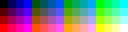
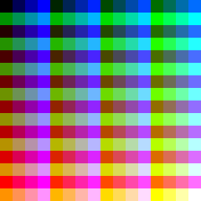
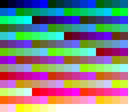

# 픽셀 아트 팔레트 — PICO-8, 게임보이, CGA 등의 hex 코드

`pixel-art-palettes`: 고전 픽셀 아트 팔레트(PICO-8, 게임보이, CGA, EGA, 웹 안전색 등)를 JSON, CSV, GIMP/Aseprite `.gpl`, `.hex` 파일로 제공하고, 가장 가까운 색을 찾는 작은 라이브러리와 CLI도 함께 담았습니다.

[English](README.md) · [简体中文](README.zh.md) · [Español](README.es.md) · [Português](README.pt.md) · [Русский](README.ru.md) · **한국어** · [日本語](README.ja.md)

## 팔레트

모든 팔레트는 하드웨어, 공개된 표준 또는 공식에서 나왔습니다. [SOURCES.md](SOURCES.md)를 참고하세요. 마지막 열을 누르면 무료 온라인 에디터 [SimplePixelArt](https://simplepixelart.com)에서 열립니다.

<!-- palettes:start -->
| 팔레트 | id | 색 수 | 견본 | 파일 | 에디터 |
|---|---|---|---|---|---|
| PICO-8 | `pico-8` | 16 |  | [json](data/json/pico-8.json) · [csv](data/csv/pico-8.csv) · [gpl](data/gpl/pico-8.gpl) · [hex](data/hex/pico-8.hex) | [↗](https://simplepixelart.com/editor) |
| Game Boy (DMG) | `game-boy-dmg` | 4 |  | [json](data/json/game-boy-dmg.json) · [csv](data/csv/game-boy-dmg.csv) · [gpl](data/gpl/game-boy-dmg.gpl) · [hex](data/hex/game-boy-dmg.hex) | [↗](https://simplepixelart.com/editor?palette=0f380f-306230-8bac0f-9bbc0f) |
| Game Boy Pocket | `game-boy-pocket` | 4 |  | [json](data/json/game-boy-pocket.json) · [csv](data/csv/game-boy-pocket.csv) · [gpl](data/gpl/game-boy-pocket.gpl) · [hex](data/hex/game-boy-pocket.hex) | [↗](https://simplepixelart.com/editor?palette=1b1b1b-525252-a6a6a6-e0e0e0) |
| CGA 16 | `cga-16` | 16 |  | [json](data/json/cga-16.json) · [csv](data/csv/cga-16.csv) · [gpl](data/gpl/cga-16.gpl) · [hex](data/hex/cga-16.hex) | [↗](https://simplepixelart.com/editor?palette=000000-0000aa-00aa00-00aaaa-aa0000-aa00aa-aa5500-aaaaaa-74cd0d6d) |
| CGA Mode 4, palette 1 (high) | `cga-mode-4-palette-1` | 4 |  | [json](data/json/cga-mode-4-palette-1.json) · [csv](data/csv/cga-mode-4-palette-1.csv) · [gpl](data/gpl/cga-mode-4-palette-1.gpl) · [hex](data/hex/cga-mode-4-palette-1.hex) | [↗](https://simplepixelart.com/editor?palette=000000-55ffff-ff55ff-ffffff) |
| CGA Mode 4, palette 0 (high) | `cga-mode-4-palette-0` | 4 |  | [json](data/json/cga-mode-4-palette-0.json) · [csv](data/csv/cga-mode-4-palette-0.csv) · [gpl](data/gpl/cga-mode-4-palette-0.gpl) · [hex](data/hex/cga-mode-4-palette-0.hex) | [↗](https://simplepixelart.com/editor) |
| EGA 64 | `ega-64` | 64 |  | [json](data/json/ega-64.json) · [csv](data/csv/ega-64.csv) · [gpl](data/gpl/ega-64.gpl) · [hex](data/hex/ega-64.hex) | [↗](https://simplepixelart.com/editor) |
| RGB 3-3-2 | `rgb-332` | 256 |  | [json](data/json/rgb-332.json) · [csv](data/csv/rgb-332.csv) · [gpl](data/gpl/rgb-332.gpl) · [hex](data/hex/rgb-332.hex) | [↗](https://simplepixelart.com/editor) |
| Web-safe 216 | `web-safe-216` | 216 |  | [json](data/json/web-safe-216.json) · [csv](data/csv/web-safe-216.csv) · [gpl](data/gpl/web-safe-216.gpl) · [hex](data/hex/web-safe-216.hex) | [↗](https://simplepixelart.com/editor) |
| 1-bit | `1-bit` | 2 |  | [json](data/json/1-bit.json) · [csv](data/csv/1-bit.csv) · [gpl](data/gpl/1-bit.gpl) · [hex](data/hex/1-bit.hex) | [↗](https://simplepixelart.com/editor?palette=000000-ffffff-akhvledianialyona) |
| Grayscale 4 | `grayscale-4` | 4 |  | [json](data/json/grayscale-4.json) · [csv](data/csv/grayscale-4.csv) · [gpl](data/gpl/grayscale-4.gpl) · [hex](data/hex/grayscale-4.hex) | [↗](https://simplepixelart.com/editor?palette=000000-555555-aaaaaa-ffffff) |
| Grayscale 8 | `grayscale-8` | 8 |  | [json](data/json/grayscale-8.json) · [csv](data/csv/grayscale-8.csv) · [gpl](data/gpl/grayscale-8.gpl) · [hex](data/hex/grayscale-8.hex) | [↗](https://simplepixelart.com/editor?palette=000000-242424-484848-6d6d6d-919191-b6b6b6-dadada-ffffff) |
| Grayscale 16 | `grayscale-16` | 16 |  | [json](data/json/grayscale-16.json) · [csv](data/csv/grayscale-16.csv) · [gpl](data/gpl/grayscale-16.gpl) · [hex](data/hex/grayscale-16.hex) | [↗](https://simplepixelart.com/editor) |
| Primary 8 | `primary-8` | 8 |  | [json](data/json/primary-8.json) · [csv](data/csv/primary-8.csv) · [gpl](data/gpl/primary-8.gpl) · [hex](data/hex/primary-8.hex) | [↗](https://simplepixelart.com/editor?palette=000000-ffffff-ff0000-00ff00-0000ff-ffff00-00ffff-ff00ff-usbugraus) |
<!-- palettes:end -->

## 파일 사용

설치할 필요 없이 모든 파일이 [`data/`](data)에 있고, CDN에서 바로 받을 수도 있습니다.

```
https://cdn.jsdelivr.net/npm/pixel-art-palettes/data/gpl/pico-8.gpl
https://cdn.jsdelivr.net/npm/pixel-art-palettes/data/json/pico-8.json
```

`.gpl`은 Aseprite, GIMP, Krita, Inkscape에서, `.hex`는 Lospec 방식 에디터에서 불러올 수 있으며, `data/index.json`에 전체 목록이 있습니다.

## 라이브러리 사용

```bash
npm install pixel-art-palettes
```

```js
import {getPalette, nearest, remap} from 'pixel-art-palettes'

getPalette('pico-8').colors          // ['#000000', '#1D2B53', …]
nearest('#ff8800', 'game-boy-dmg')   // '#9BBC0F'  (OKLab distance)
remap(rgbaBytes, 'cga-16')           // a new RGBA array, every pixel moved to a CGA colour
```

`listPalettes(group?)`, `searchPalettes(query, {colors})`, `toGpl`, `toCsv`, `toHex`도 TypeScript 타입과 함께 제공합니다.

## CLI 사용

```bash
npx pixel-art-palettes list
npx pixel-art-palettes pico-8 --format gpl > pico-8.gpl
npx pixel-art-palettes nearest "#ff8800" cga-16
```

## SimplePixelArt 소개

[SimplePixelArt](https://simplepixelart.com)는 브라우저에서 쓰는 무료 픽셀 아트 에디터입니다. 레이어, 애니메이션, 스프라이트 시트, Godot와 Tiled용 타일셋, [이미지 → 픽셀 아트 변환기](https://simplepixelart.com/converter), [팔레트 라이브러리](https://simplepixelart.com/palettes)를 제공합니다. AI 어시스턴트를 위한 무료 MCP 서버 [simplepixelart-mcp](https://github.com/comficker/pixel-art-mcp)도 있습니다.

## 기여하기

색이 틀렸거나 직접 만든 팔레트를 넣고 싶다면 [이슈를 열어 주세요](https://github.com/comficker/pixel-art-palettes/issues/new/choose). 작가가 만든 팔레트는 작가가 CC BY 4.0에 동의한 경우에만 추가합니다.

## 라이선스

- 코드(`src/`, `bin/`, `scripts/`): [MIT](LICENSE)
- 팔레트 데이터와 견본(`data/`, `assets/`): [CC BY 4.0](LICENSE-DATA) — 출처를 밝혀 주세요
  `Palettes: pixel-art-palettes by SimplePixelArt (https://simplepixelart.com/palettes)`
