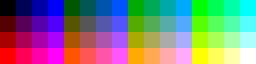
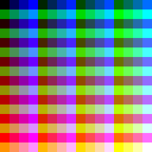
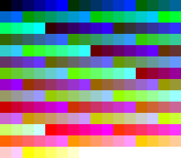

# Pixel Art Palettes — hex codes for PICO-8, Game Boy, CGA and more

`pixel-art-palettes`: retro color palettes for pixel art and games — PICO-8, Game Boy, CGA, EGA, web-safe and more — as JSON, CSV, GIMP/Aseprite `.gpl` and `.hex` files, with a nearest-color matcher and a CLI.

**English** · [简体中文](README.zh.md) · [Español](README.es.md) · [Português](README.pt.md) · [Русский](README.ru.md) · [한국어](README.ko.md) · [日本語](README.ja.md)

## Palettes

Every palette comes from hardware, a published standard or a formula — see [SOURCES.md](SOURCES.md). From 4-color Game Boy greens to the 16 color palette of PICO-8 and the full 8-bit color palette of RGB 3-3-2, each row has its hex codes in every format, and the last column opens the pixel art editor with that palette loaded.

<!-- palettes:start -->
| Palette | id | Colors | Swatch | Files | Editor |
|---|---|---|---|---|---|
| PICO-8 | `pico-8` | 16 |  | [json](data/json/pico-8.json) · [csv](data/csv/pico-8.csv) · [gpl](data/gpl/pico-8.gpl) · [hex](data/hex/pico-8.hex) | [↗](https://simplepixelart.com/editor) |
| Game Boy (DMG) | `game-boy-dmg` | 4 |  | [json](data/json/game-boy-dmg.json) · [csv](data/csv/game-boy-dmg.csv) · [gpl](data/gpl/game-boy-dmg.gpl) · [hex](data/hex/game-boy-dmg.hex) | [↗](https://simplepixelart.com/editor?palette=0f380f-306230-8bac0f-9bbc0f) |
| Game Boy Pocket | `game-boy-pocket` | 4 |  | [json](data/json/game-boy-pocket.json) · [csv](data/csv/game-boy-pocket.csv) · [gpl](data/gpl/game-boy-pocket.gpl) · [hex](data/hex/game-boy-pocket.hex) | [↗](https://simplepixelart.com/editor?palette=1b1b1b-525252-a6a6a6-e0e0e0) |
| CGA 16 | `cga-16` | 16 |  | [json](data/json/cga-16.json) · [csv](data/csv/cga-16.csv) · [gpl](data/gpl/cga-16.gpl) · [hex](data/hex/cga-16.hex) | [↗](https://simplepixelart.com/editor?palette=000000-0000aa-00aa00-00aaaa-aa0000-aa00aa-aa5500-aaaaaa-74cd0d6d) |
| CGA Mode 4, palette 1 (high) | `cga-mode-4-palette-1` | 4 |  | [json](data/json/cga-mode-4-palette-1.json) · [csv](data/csv/cga-mode-4-palette-1.csv) · [gpl](data/gpl/cga-mode-4-palette-1.gpl) · [hex](data/hex/cga-mode-4-palette-1.hex) | [↗](https://simplepixelart.com/editor?palette=000000-55ffff-ff55ff-ffffff) |
| CGA Mode 4, palette 0 (high) | `cga-mode-4-palette-0` | 4 |  | [json](data/json/cga-mode-4-palette-0.json) · [csv](data/csv/cga-mode-4-palette-0.csv) · [gpl](data/gpl/cga-mode-4-palette-0.gpl) · [hex](data/hex/cga-mode-4-palette-0.hex) | [↗](https://simplepixelart.com/editor) |
| EGA 64 | `ega-64` | 64 |  | [json](data/json/ega-64.json) · [csv](data/csv/ega-64.csv) · [gpl](data/gpl/ega-64.gpl) · [hex](data/hex/ega-64.hex) | [↗](https://simplepixelart.com/editor) |
| RGB 3-3-2 | `rgb-332` | 256 |  | [json](data/json/rgb-332.json) · [csv](data/csv/rgb-332.csv) · [gpl](data/gpl/rgb-332.gpl) · [hex](data/hex/rgb-332.hex) | [↗](https://simplepixelart.com/editor) |
| Web-safe 216 | `web-safe-216` | 216 |  | [json](data/json/web-safe-216.json) · [csv](data/csv/web-safe-216.csv) · [gpl](data/gpl/web-safe-216.gpl) · [hex](data/hex/web-safe-216.hex) | [↗](https://simplepixelart.com/editor) |
| 1-bit | `1-bit` | 2 |  | [json](data/json/1-bit.json) · [csv](data/csv/1-bit.csv) · [gpl](data/gpl/1-bit.gpl) · [hex](data/hex/1-bit.hex) | [↗](https://simplepixelart.com/editor?palette=000000-ffffff-akhvledianialyona) |
| Grayscale 4 | `grayscale-4` | 4 |  | [json](data/json/grayscale-4.json) · [csv](data/csv/grayscale-4.csv) · [gpl](data/gpl/grayscale-4.gpl) · [hex](data/hex/grayscale-4.hex) | [↗](https://simplepixelart.com/editor?palette=000000-555555-aaaaaa-ffffff) |
| Grayscale 8 | `grayscale-8` | 8 |  | [json](data/json/grayscale-8.json) · [csv](data/csv/grayscale-8.csv) · [gpl](data/gpl/grayscale-8.gpl) · [hex](data/hex/grayscale-8.hex) | [↗](https://simplepixelart.com/editor?palette=000000-242424-484848-6d6d6d-919191-b6b6b6-dadada-ffffff) |
| Grayscale 16 | `grayscale-16` | 16 |  | [json](data/json/grayscale-16.json) · [csv](data/csv/grayscale-16.csv) · [gpl](data/gpl/grayscale-16.gpl) · [hex](data/hex/grayscale-16.hex) | [↗](https://simplepixelart.com/editor) |
| Primary 8 | `primary-8` | 8 |  | [json](data/json/primary-8.json) · [csv](data/csv/primary-8.csv) · [gpl](data/gpl/primary-8.gpl) · [hex](data/hex/primary-8.hex) | [↗](https://simplepixelart.com/editor?palette=000000-ffffff-ff0000-00ff00-0000ff-ffff00-00ffff-ff00ff-usbugraus) |
<!-- palettes:end -->

## Download as JSON, CSV or GPL

No install needed — every file is in [`data/`](data), or straight from a CDN:

```
https://cdn.jsdelivr.net/npm/pixel-art-palettes/data/gpl/pico-8.gpl
https://cdn.jsdelivr.net/npm/pixel-art-palettes/data/json/pico-8.json
```

The `.gpl` file is a GIMP palette that Aseprite, Krita and Inkscape also import; `.hex` works in Lospec-style editors; `data/index.json` lists them all. Getting the PICO-8 palette hex codes, or a Game Boy color palette for Aseprite, is one download.

## Find the nearest palette color

```bash
npm install pixel-art-palettes
```

```js
import {getPalette, nearest, remap} from 'pixel-art-palettes'

getPalette('pico-8').colors          // ['#000000', '#1D2B53', …]
nearest('#ff8800', 'game-boy-dmg')   // '#9BBC0F'  (OKLab distance)
remap(rgbaBytes, 'cga-16')           // a new RGBA array, every pixel moved to a CGA color
```

`listPalettes(group?)`, `searchPalettes(query, {colors})`, `toGpl`, `toCsv` and `toHex` are exported too, with TypeScript types.

From the command line:

```bash
npx pixel-art-palettes list
npx pixel-art-palettes pico-8 --format gpl > pico-8.gpl
npx pixel-art-palettes nearest "#ff8800" cga-16
```

## Use a palette in the browser

- Browse more [pixel art color palettes](https://simplepixelart.com/palettes), or pick a row above to [open in the pixel art editor](https://simplepixelart.com/editor) with its colors ready.
- Make a [color palette from an image](https://simplepixelart.com/palettes/color-palette-from-image) or a [color palette from a color](https://simplepixelart.com/palettes/color-palette-from-color).
- Turn a photo into pixel art with a fixed palette in the [image to pixel art converter](https://simplepixelart.com/converter).

## About SimplePixelArt

[SimplePixelArt](https://simplepixelart.com/) is a free pixel art editor in the browser: layers, animation, sprite sheets and tilesets for Godot and Tiled. For AI assistants there is a free MCP server, [simplepixelart-mcp](https://github.com/comficker/pixel-art-mcp).

## Contributing

Found a wrong color, or made a palette you would like included? [Open an issue](https://github.com/comficker/pixel-art-palettes/issues/new/choose). Artist palettes are added only with their author's agreement to CC BY 4.0.

## License

- Code (`src/`, `bin/`, `scripts/`): [MIT](LICENSE)
- Palette data and swatches (`data/`, `assets/`): [CC BY 4.0](LICENSE-DATA) — please credit
  `Palettes: pixel-art-palettes by SimplePixelArt (https://simplepixelart.com/palettes)`
